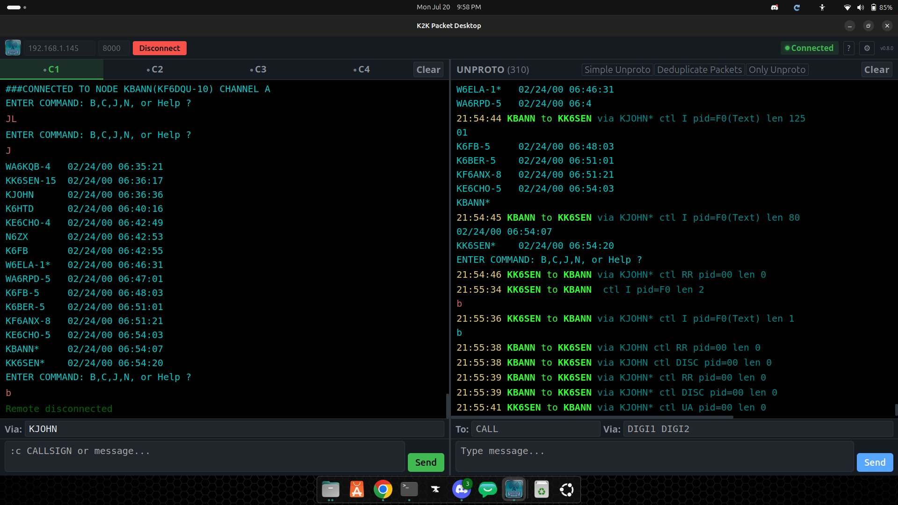
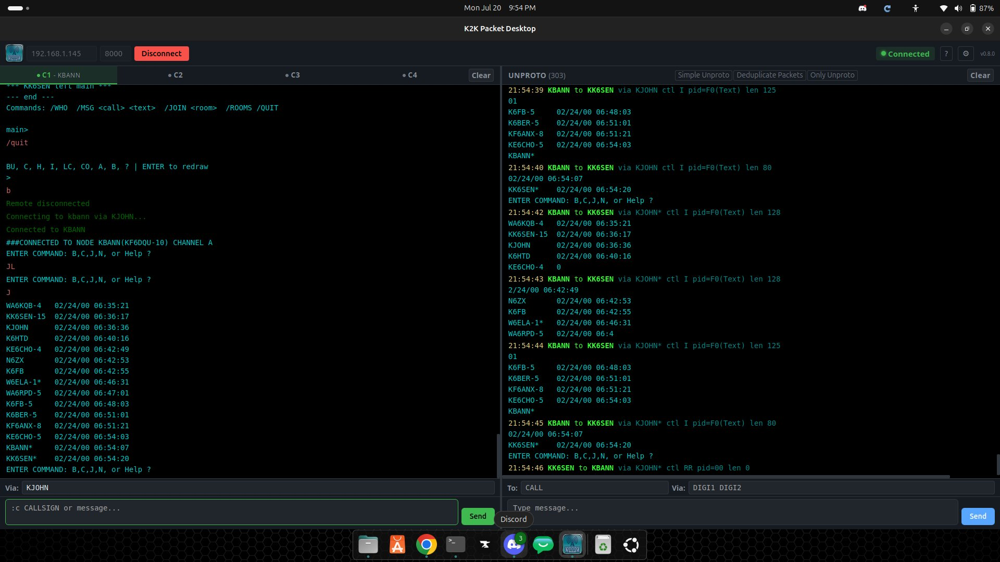
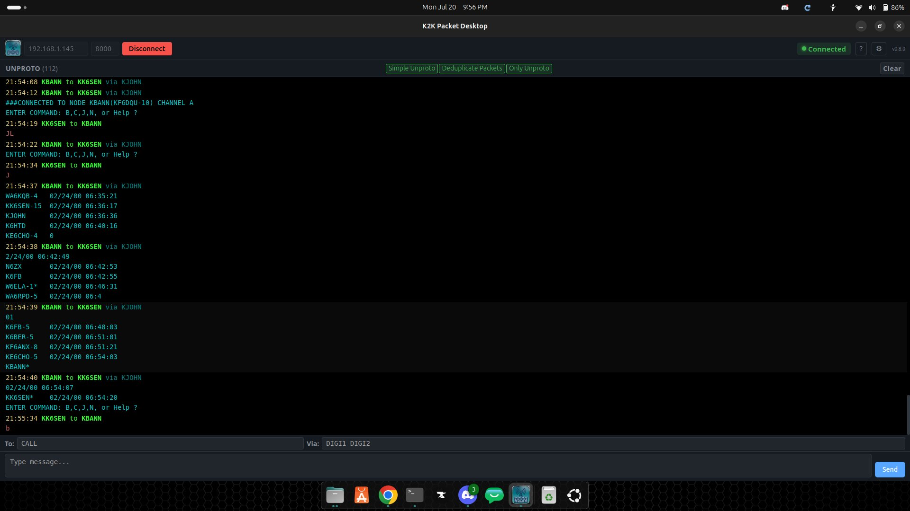
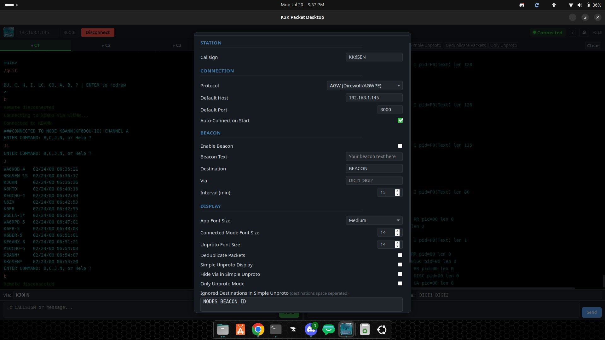
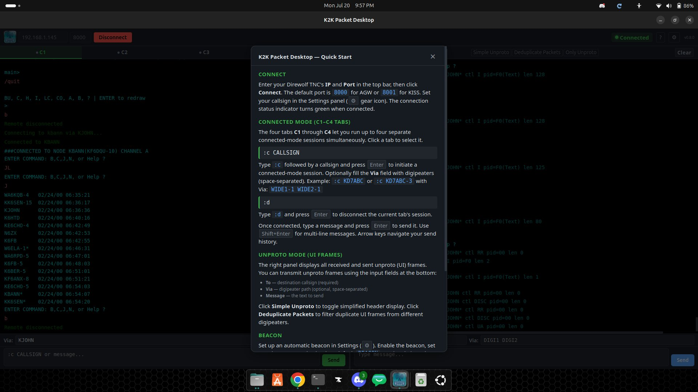
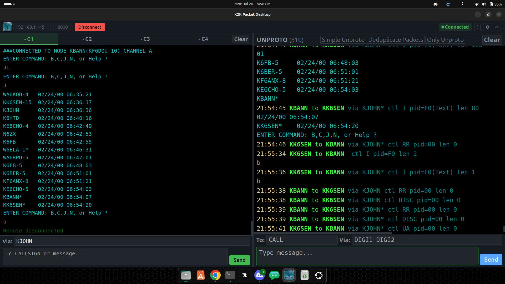

# K2K Packet Desktop


[](LICENSE)
[](https://github.com/Josh-kk6sen/k2k-packet-desktop/releases/latest)

A cross-platform **KISS packet radio terminal** for Windows and Linux — matching the look and feel of the K2K Packet Android app.

> **📥 Download the latest installers** (Windows `.exe` + Debian `.deb`) from the **[Releases page](https://github.com/Josh-kk6sen/k2k-packet-desktop/releases/latest)**.
> Or build from source — see [Getting started](#getting-started) below.

Connects over TCP to any KISS-compatible TNC and provides a full connected-mode AX.25 terminal. Tested against the Direwolf software TNC.


## Features

- **KISS-over-TCP** connection to any KISS-compatible TNC
- **4 connection tabs** with chat, plus a live unproto (monitor) panel
- **Callsign routing** via digipeaters (closest digipeater auto-selected)
- **AX.25 connected-mode** with a kernel-faithful protocol implementation
- **Network + local BBS / PBBS** support
- Full **settings page** (protocol, callsign, fonts, colors, beacon, dedup)
- Dark theme with the K2K color scheme
- Windows + Linux from a single codebase
- Built with [Tauri](https://tauri.app) v2 (Rust backend, HTML/CSS/JS frontend)

## Architecture

- **Frontend** (`src/`) — vanilla JS modules loaded by `index.html`, built with Vite. No framework; the whole UI lives in `src/`.
- **Backend** (`src-tauri/`) — Rust Tauri commands implementing the KISS layer, AGWPE frame routing, AX.25 session state machines, history/settings persistence, and logging.
- **Tests** (`tests/frontend/`) — jsdom-based smoke test that loads the real production module graph and asserts DOM wiring + window globals.

## Screenshots



| | |
|---|---|
|  |  |
|  |  |
|  | &nbsp; |

## Getting started

**Prerequisites:** Node.js 22+, Rust stable, and the [Tauri v2 prerequisites](https://v2.tauri.app/start/prerequisites/).

```bash
npm install        # install frontend deps
npm run test:frontend   # run the frontend smoke test
npm run dev        # launch the app in dev mode
```

Build installers:

```bash
npm run build                  # build frontend
cd src-tauri && cargo build --release   # build backend
npx tauri build                # bundle installers
```

## Configuration

Set your TNC in the app's Settings page. The default protocol is **AGWPE**; switch to **KISS** if your TNC speaks KISS over TCP. No config files need editing to get started.

## CI

`.github/workflows/ci.yml` runs on every push/PR:
1. **Frontend** — Vite build + the jsdom smoke test (Node 22)
2. **Rust** — `cargo check` + `cargo test`
3. **Windows cross-check** — verifies the Rust backend cross-compiles for
   Windows (MinGW) from Linux, exercising the `x86_64-pc-windows-gnu` linker
   config in `src-tauri/.cargo/config.toml`.

Note: `live_test.rs` integration tests skip (not fail) when the KISS/AGW sim
service on `:8181`/`:8182` isn't running — they don't add coverage in CI.

Release installers (`.exe`/`.deb`) are produced and published as GitHub
Release artifacts on tag pushes; see `.github/workflows/release.yml`.

## License

[GPL-3.0](LICENSE) © Josh / KK6SEN