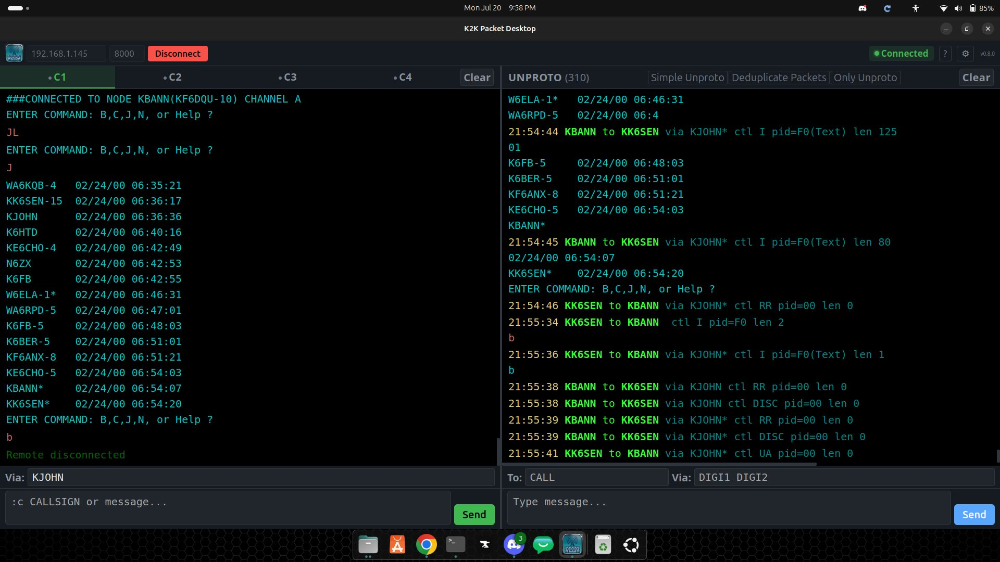
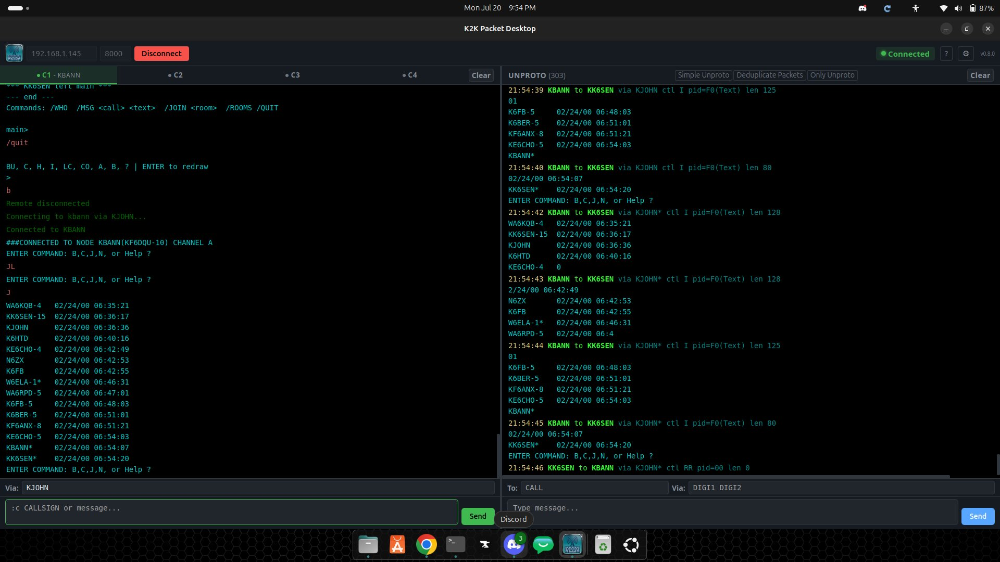
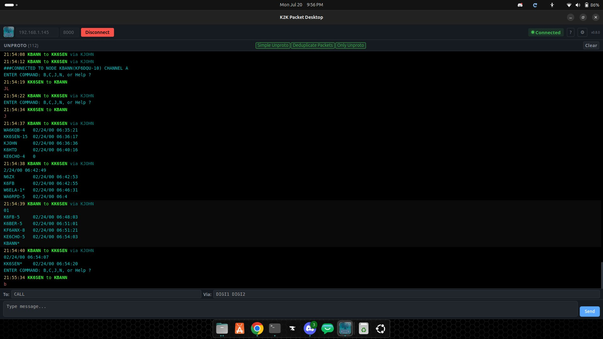
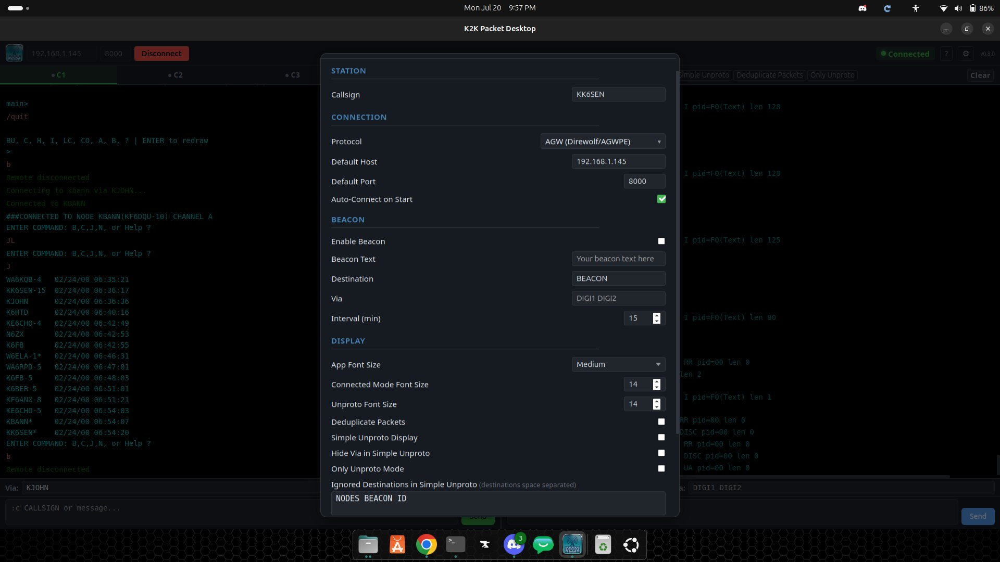
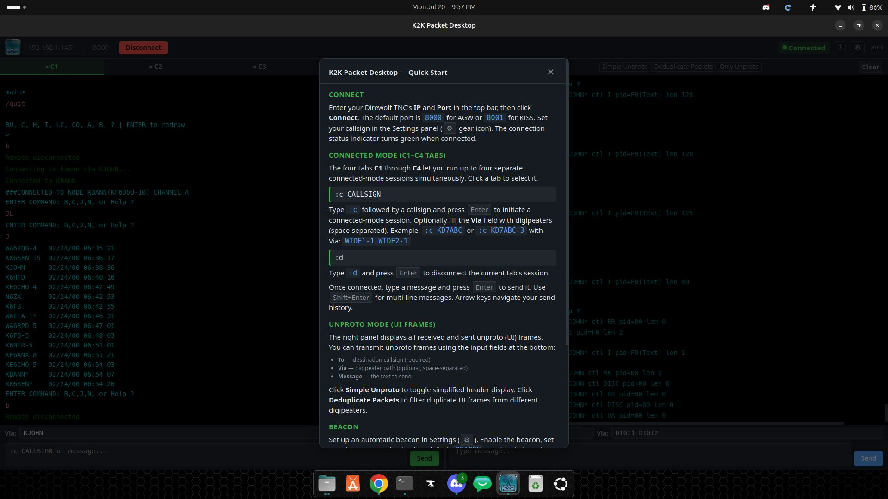
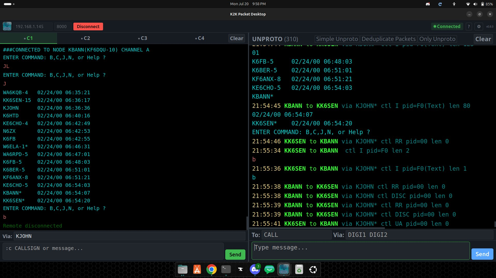

# K2K Packet Desktop


[](LICENSE)
[](https://github.com/Josh-kk6sen/k2k-packet-desktop/releases/latest)

A cross-platform **KISS and AGWPE packet radio terminal** for Windows, MacOS, and Linux.

> **📥 Download the latest installers** — Windows `.exe`, macOS universal `.dmg`, and Linux `.deb` (amd64 desktop, arm64 desktop, armhf headless for Raspberry Pi) — from the **[Releases page](https://github.com/Josh-kk6sen/k2k-packet-desktop/releases/latest)**.
> Or build from source — see [Getting started](#getting-started) below.

Connects over TCP to any KISS-compatible or AGWPE TNC and provides a full connected-mode AX.25 terminal. Tested against the Direwolf software TNC.


## Features

- **KISS or AGWPE over TCP** to any compatible TNC
- **4 connection tabs** with chat, plus a live unproto (monitor) panel
- **Callsign routing** via digipeaters (closest digipeater auto-selected)
- **AX.25 connected-mode** with a kernel-faithful protocol implementation
- **Network + local BBS / PBBS** support
- Full **settings page** (protocol, callsign, fonts, colors, beacon, dedup)
- Dark theme with the K2K color scheme
- **Headless mode on every build** — run with `--web` to serve the same client to a browser, no GUI stack required
- Windows, macOS, and Linux from a single codebase
- Built with [Tauri](https://tauri.app) v2 (Rust backend, HTML/CSS/JS frontend)

## Architecture

- **Frontend** (`src/`) — vanilla JS modules loaded by `index.html`, built with Vite. No framework; the whole UI lives in `src/`. It talks to the backend through `src/transport.js`, so the same client runs inside Tauri or a browser.
- **Backend core** (`src-tauri/src/`) — Rust: KISS and AGWPE link layers, the AX.25 kernel (session, timers, BBS/PBBS, NET/ROM), settings/history persistence, and logging. Protocol and session code is shared; only the shell differs.
- **Two shells** — the desktop app registers Tauri commands in `commands.rs`; web/headless mode serves the identical client over HTTP/WebSocket from `web.rs`. Outward effects go through `app::Out`, so neither shell leaks into the protocol core.
- **Headless package** (`src-tauri/src/bin/k2k-headless.rs`) — the same code compiled without Tauri/GTK/WebKitGTK, a few MB installed. The GUI builds support headless mode too; this package is for machines that have no GUI stack at all.
- **Tests** — `tests/frontend/` runs a jsdom smoke test over the real production module graph (DOM wiring + window globals); Rust unit tests cover the kernel. Live KISS/AGW integration tests skip when the sim service isn't running.

## Screenshots



| | |
|---|---|
|  |  |
|  |  |
|  | &nbsp; |

## Getting started

**Prerequisites:** Node.js 22+, Rust stable, and the [Tauri v2 prerequisites](https://v2.tauri.app/start/prerequisites/).

```bash
npm install        # install frontend deps
npm run test:frontend   # run the frontend smoke test
npm run dev        # launch the app in dev mode
```

Build installers:

```bash
npm run build                  # build frontend
cd src-tauri && cargo build --release   # build backend
npx tauri build                # bundle installers

# headless build (no Tauri/GTK/WebKitGTK)
cd src-tauri && cargo build --release --no-default-features --bin k2k-headless
```

## Headless mode

Every build — Windows `.exe`, macOS `.dmg`, desktop `.deb`, and the dedicated
headless package — can run without a window and serve the UI to any browser on
your network:

```bash
k2k-packet-desktop --web            # desktop build, default port 8080
k2k-packet-desktop --web 8081       # bare port shorthand
k2k-headless --web --port 8080 --bind 0.0.0.0   # headless package
```

Then open `http://<host-ip>:8080/` from another machine. The browser client reads
and writes the same settings, history, message board, and logs as the desktop
app — the two are interchangeable front ends to one backend.

For a Raspberry Pi or DigiPi running the armhf headless `.deb`, a systemd unit
keeps it up:

```ini
[Unit]
Description=K2K Packet Desktop (headless)
After=network-online.target

[Service]
ExecStart=/usr/bin/k2k-headless --web --port 8080
Restart=on-failure
User=<your-user>

[Install]
WantedBy=multi-user.target
```

**Security:** there is no password and no TLS. Run it only on a trusted LAN, or
put a reverse proxy with authentication in front of it before exposing it.

## Configuration

Set your TNC in the app's Settings page. The default protocol is **AGWPE**; switch to **KISS** if your TNC speaks KISS over TCP. No config files need editing to get started.

## CI

`.github/workflows/ci.yml` runs on every push/PR:
1. **Frontend** — Vite build + the jsdom smoke test (Node 22)
2. **Rust** — `cargo check` + `cargo test`
3. **Windows cross-check** — verifies the Rust backend cross-compiles for
   Windows (MinGW) from Linux, exercising the `x86_64-pc-windows-gnu` linker
   config in `src-tauri/.cargo/config.toml`.

Note: `live_test.rs` integration tests skip (not fail) when the KISS/AGW sim
service on `:8181`/`:8182` isn't running — they don't add coverage in CI.

CI covers Linux only — macOS is built on release, not tested per-push.

Release installers are produced and published as GitHub Release artifacts on
tag pushes; see `.github/workflows/release.yml`:

- Windows `.exe` installer (cross-compiled with MinGW)
- macOS universal `.dmg` (Intel + Apple Silicon)
- Linux `.deb` — amd64 desktop, arm64 desktop, and armhf headless

## License

[GPL-3.0](LICENSE) © Josh / KK6SEN